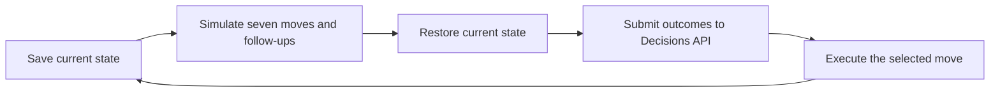
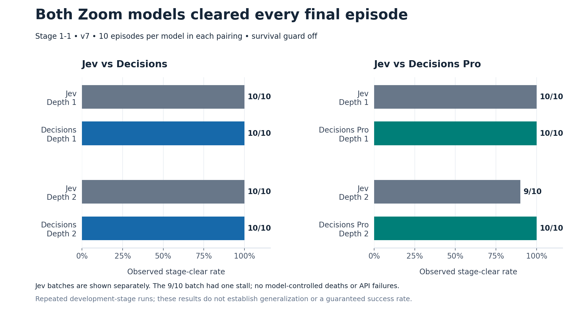
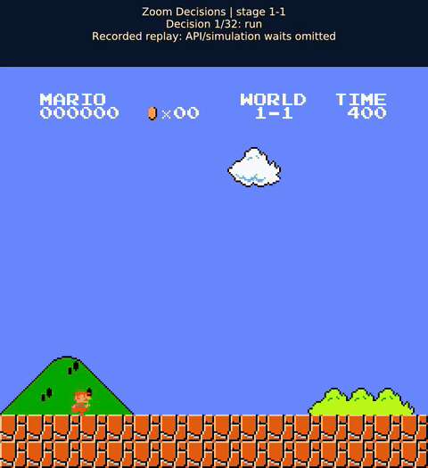
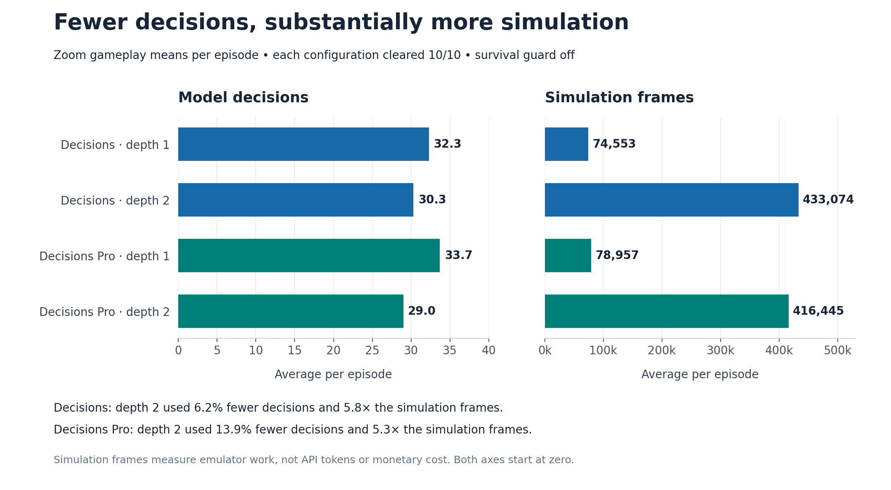

# Seven Moves, One Flag: Putting Zoom Decisions to the Mario Test

A decision API returns a small answer. In a game, that answer can have a very visible consequence: Mario advances, stalls, or falls into a pit.

[Zoom Decisions API](https://developers.zoom.us/docs/ai-services/decisions/) lets applications ask structured questions about supplied input: whether a condition is true (`predicate`), which option to select (`choice`), or how to rate something against defined levels (`score`). It returns structured answers that application code can use. For Mario, we used the `choice` format to select a move from seven candidates and compared the standard Decisions model with Decisions Pro.

We built a Super Mario Bros. stage-1-1 experiment around Zoom Decisions API to explore that connection. In the final default-depth evaluation, **Zoom Decisions and Decisions Pro each cleared the stage in all 10 episodes, without a survival guard**. TypeSafe Jev, our comparison model, also cleared all 10 episodes in each pairing.

Getting there was more interesting than the final score. An earlier Pro configuration died on every attempt, while Jev repeatedly stalled. Saved checkpoints helped us investigate those failures and improve the evidence supplied to every model.

This is an engineering case study on one development stage, not a general ranking of the models.

## What the model actually controls

The model does not receive screenshots and play directly from pixels in this experiment. Before each decision, the emulator saves its state and simulates seven candidate moves:

`run`, `walk`, `jump`, `run_jump`, `hop`, `wait`, and `back`.

It measures the outcomes, restores the original state, and submits structured evidence to the model. The model selects one move; only that move executes. Hypothetical follow-ups are never executed automatically.



We used the API's native `choice` question. Each choice had an action label and a description containing its measured outcome. The response provided an explicit selection and a probability distribution. The runner honored the returned selection; probabilities were logged rather than treated as calibrated guarantees of success.

The game paused during simulation and API inference. Consequently, API latency affected elapsed runtime but did not make Mario continue moving while waiting for a response. Real-time control would be a different experiment.

## Selecting Decisions or Decisions Pro

Both variants use `POST https://api.zoom.us/v2/aiservices/decisions/decide`. The documented model values are `zoom-decisions` and `zoom-decisions-pro`; standard Decisions is the service default. Pro requires explicit selection and may need an additional entitlement.

The released reference specifies a bearer access token, the `aiservices:write:decide:admin` scope, and a Zoom AI Services or Universal SDK entitlement. The repository also retains legacy API-key support for the earlier sample integration. Request logs do not establish which authentication path the local runs used.

This example uses the repository's shared payload builder so the action descriptions and instructions are the same ones used by the comparison harness. `canonical` is the saved state and simulated outcomes produced by the simulator:

```python
import json
import os
import urllib.request

from mario_eval.rankers import payload_for


def select_move(canonical, model="zoom-decisions"):
    payload = payload_for(
        "zoom", canonical, zoom_question="choice", zoom_model=model
    )
    request = urllib.request.Request(
        "https://api.zoom.us/v2/aiservices/decisions/decide",
        data=json.dumps(payload).encode(),
        headers={
            "Authorization": f"Bearer {os.environ['ZOOM_ACCESS_TOKEN']}",
            "Content-Type": "application/json",
        },
        method="POST",
    )
    with urllib.request.urlopen(request, timeout=30) as response:
        result = json.load(response)
    if result.get("model") != model:
        raise ValueError("Unexpected returned model")
    return result["answers"][0]["choice"]
```

This is a focused integration example, not a replacement for the full harness. The harness also validates the answer and candidate scores, enforces a total request deadline, and records diagnostic metadata. No live call from this snippet was used to generate the results below.

## Why the first experiments failed

In an earlier ten-episode batch, standard Decisions cleared 10/10, but Pro died 10/10 at the same point. Jev mostly stalled later in the level.

Comparing whole episodes alone could not explain the difference: once models choose different moves, they encounter different states. We therefore saved exact checkpoints and gave each model identical evidence.

At one checkpoint, standard Decisions selected `run_jump` while Pro selected `hop`. Both initially survived and had viable follow-ups. The shorter hop was not inherently fatal; the failure developed across later choices.

A deeper simulator investigation exposed a useful distinction at `x=1823`. The selected `walk` survived over the short horizon, but every tested three-move route through it ended in death. A `wait` had seven observed surviving three-move routes. Those counts describe enumerated paths, not probabilities or guarantees of eventual completion.

Jev's stall revealed another issue: a stationary move could receive positive *hypothetical* progress because a later jump would advance. That progress still required a future decision. Repeatedly deferring it could leave Mario in the same area.

## Making the evidence clearer

We changed the shared instructions and evidence for all providers:

- Separate immediate displacement and immediate stage completion from progress requiring a future move.
- Use recent executed decisions to recognize repeated non-progress.
- Preserve survival as the higher priority; waiting and retreating can be necessary.
- Optionally expose a third-move summary so longer-horizon traps are visible.

Depth 1 means a candidate plus one follow-up. Depth 2 means a candidate plus two follow-ups. The default remains depth 1. The survival guard was disabled throughout the final evaluations.

One integration regression also mattered: expanded instructions accompanied HTTP 400 failures from Zoom. Compacting the shared instructions from 2,378 to 1,300 characters was followed by successful requests. The rejected response bodies were not retained, so an instruction-length limit remains a hypothesis, not a verified API constraint.

These changes were prompt and evidence engineering, not model-weight fine-tuning.

## Benchmark design and parameters

This was a custom, simulation-assisted benchmark on **Super Mario Bros. stage 1-1**, not an official Hugging Face benchmark. The final gameplay evaluation had four batches: Jev versus Decisions at depth 1 and depth 2, and Jev versus Decisions Pro at depth 1 and depth 2.

**Sample size and environment.** Each batch contained ten episodes per model, using emulator seeds 123–132 in `SuperMarioBros-1-1-v0`. That produced 80 model-controlled episodes: 40 Jev, 20 Decisions, and 20 Pro. The search baseline ran another 40 episodes, reported separately. Different seeds on this fixed layout do not represent different levels or independently sampled tasks.

**Models.** Jev was requested through `jev-latest`; responses identified **`jev-1.13.0`**. Jev 1.14.0 was not evaluated. Zoom was explicitly requested as **`zoom-decisions`** or **`zoom-decisions-pro`**, and the returned identifiers were checked. These service identifiers are not immutable weight snapshots.

**Shared task and inputs.** Both services used native `choice` questions, the same objective, and the same seven action macros: `run`, `walk`, `jump`, `run_jump`, `hop`, `wait`, and `back`. The shared prompt was `outcome-ranker-v7`, the evidence format was `progress-cycles-v2`, and the action set was `simple-macros-v1`. Inputs described simulator-measured outcomes rather than screenshots. The final gameplay runs used independent parallel lanes: each model chose its own trajectory. After their choices diverged, their observations could differ. The earlier identical-state checkpoint tests were a separate diagnostic evaluation.

**Simulation settings.** The candidate horizon was 48 frames, with a landing cap of 72 additional frames and 4 settling frames. Depth 1 tested a candidate plus one follow-up; depth 2 tested a candidate plus two follow-ups, using continuation set `all-seven-airborne-v2`. These settings were shared within each pairing. Simulation frames include hypothetical exploration and are distinct from executed gameplay frames.

**Assistance and timing.** Survival guard, automatic escape, and automatic follow-up execution were all disabled. The emulator paused during inference and simulation. Parallel lanes therefore did not turn this into a real-time reaction test; latency affected runtime rather than the number of frames Mario moved while awaiting a decision.

**Stopping limits per policy episode:**

- Maximum 100 decisions.
- Maximum 3,600 executed gameplay frames.
- Maximum 1,000,000 simulation frames.
- Maximum 1,200 wall-clock seconds.
- Stall threshold: 360 gameplay frames without a new best position.
- API timeout: 30 seconds per request.

**Model sampling parameters.** The harness did not send temperature, top-p, inference seed, or output limits to either service. Effective service defaults were unknown, so matching decoding behavior was not established. Emulator seeds control the environment; they are not model inference seeds.

**Metrics.** The primary outcome was stage-clear count: the emulator's completion flag, recorded as `reason: "completed"`. Secondary measures included death, stall and provider-error counts, best horizontal position, decisions per episode, simulation frames, and API latency. Decision count measures selection frequency; simulation frames measure emulator work. Neither is a substitute for dollar cost. Latency was observational because execution overlapped.

**Software recorded with the runs.** Python 3.13.16, `gym-super-mario-bros` 9.1.0, `nes-py` 9.0.1, `gymnasium` 1.4.0, NumPy 2.5.4, and `typesafe-sdk` 0.7.5. The source manifest records the application commit and the unresolved local-change caveat discussed below.

## The final gameplay results

| Pairing | Depth | Jev stage clears | Zoom stage clears | Zoom mean decisions | Zoom mean simulation frames |
| --- | ---: | ---: | ---: | ---: | ---: |
| Jev vs Decisions | 1 | 10/10 | 10/10 | 32.3 | 74,553 |
| Jev vs Pro | 1 | 10/10 | 10/10 | 33.7 | 78,957 |
| Jev vs Decisions | 2 | 10/10 | 10/10 | 30.3 | 433,074 |
| Jev vs Pro | 2 | 9/10 | 10/10 | 29.0 | 416,445 |



There were no model-controlled deaths or API failures in these final batches. The one unsuccessful Jev episode stalled. The deterministic search baseline stalled in all 40 of its episodes; it retained its original selection rule and did not use the new third-move summary for scoring.

Here, a clear means the emulator reported reaching the flag and completing **stage 1-1**, not finishing every level of Super Mario Bros. The corresponding report field is `reason: "completed"`.

[Watch an annotated standard-Decisions clear](assets/decisions-stage-1-1-replay.mp4). This is a verified replay of recorded controller inputs, with simulation and API waiting time omitted. It is not a live-latency demonstration. On-screen labels show the recorded model-selected move.



*Recorded standard-Decisions replay. Simulation and API waiting time omitted; this is not real-time playback.*

## Is deeper lookahead worth it?

On this stage, depth 1 already achieved 10/10 for both Zoom variants. Depth 2 reduced average decisions from 32.3 to 30.3 for standard Decisions and from 33.7 to 29.0 for Pro. But it required approximately 5.8× and 5.3× as many simulation frames, respectively.



That makes depth 1 the practical baseline for this task. Pro used the fewest decisions at depth 2, but there was no additional Zoom completion benefit to offset the extra simulation work in these batches.

Median recorded API latency was about 1.13 seconds for standard Decisions and 1.42 seconds for Pro in their depth-1 batches. These are observations from this setup, not service benchmarks: batch timing indicates overlapping execution, which may affect latency and runtime. We recorded usage but did not establish monetary cost. Fewer decisions do not necessarily mean lower cost, because request size, caching, and pricing also matter.

## What about cost?

Completion rate is only part of the decision. For a practical deployment, we also need to know what each successful outcome costs.

This experiment did **not establish dollar costs**, so it cannot identify the cheapest model. Usage was recorded, but we have not reconciled complete per-run usage with verified pricing for each service, including cached-input rates and any applicable account terms.

There are two costs to separate:

- **API cost:** billable input and output usage across every request, including any billable retries or failed attempts. Request count alone is insufficient: longer evidence can increase input usage, caching can change charges, and standard and Pro may have different rates.
- **Simulation cost:** the CPU time and infrastructure used to generate candidate outcomes. Deeper lookahead required roughly five to six times as many simulation frames here. That is extra emulator work, not a measured five-to-sixfold increase in dollars.

A useful follow-up would report total API spend, simulation compute cost, and **cost per successful stage clear** alongside completion rate. Cost per clear should divide the total cost of the entire batch—including unsuccessful episodes—by the number of clears. If a batch has no clears, that metric is undefined rather than zero.

At depth 1, both Zoom variants cleared all ten episodes. Pro therefore showed no additional completion benefit in that batch to weigh against any price difference. At depth 2, Pro used fewer decisions, but that alone does not establish lower cost or better value. A cost recommendation needs the billing evidence as well as the gameplay results.

## What this experiment establishes

Zoom Decisions API worked as a structured action selector in this simulation-assisted setup. Both variants completed every final Zoom episode, and controlled checkpoint tests helped reveal where better evidence could change choices.

It does not establish that Zoom universally outperforms Jev, that Pro is universally better than standard Decisions, or that these models can play unaided from pixels. The level and failure checkpoints were used during development. Ten repeated episodes on one layout, even with different seeds, do not establish generalization or guarantee a 100% future clear rate.

The uploaded runs record commit `ee7581e1ca80fa23f63e43add60a79522507b551`, prompt `outcome-ranker-v7`, and evidence `progress-cycles-v2`, but also record `dirty: true`. The local source diff was not supplied, so exact source reproducibility is unresolved. Model IDs are aliases, not immutable weight versions.

The useful next experiment is a frozen configuration on unseen levels or starting conditions. For this case study, the central lesson is already concrete: a decision API needs evidence that distinguishes what an action accomplishes now from what might become possible later.

## References and accompanying data

- [Experiment repository](https://github.com/jenzushsu/super-mario-eval).
- [Zoom AI Services API reference](https://developers.zoom.us/docs/api/ai-services.md), reviewed from the user-uploaded Markdown reference.
- [4esv/jev-mario](https://github.com/4esv/jev-mario), methodology reference for simulation-assisted Mario evaluation; its assistance differs from this implementation.
- [Hugging Face Lighteval](https://github.com/huggingface/lighteval), a reference for custom tasks, metrics, and per-sample evaluation. This experiment used our own runner, not Lighteval, and is not an official Hugging Face benchmark.
- [Machine-readable final results](results.csv) and [source manifest](source-manifest.json).
