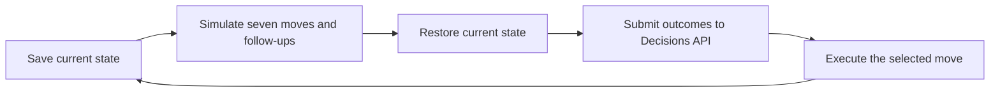
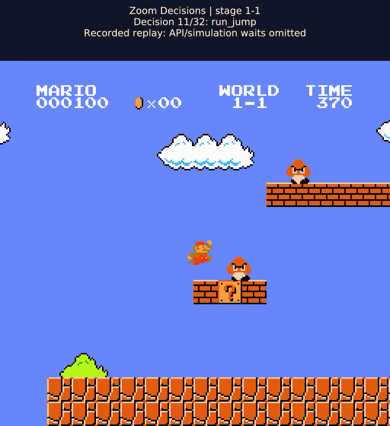

# From API to flag: testing Zoom Decisions with Super Mario

A decision API returns a small answer. In a game, that answer can have a very visible consequence: Mario advances, stalls, or falls into a pit.

We built a Super Mario Bros. stage-1-1 experiment around Zoom Decisions API to explore that connection. In the final default-depth evaluation, **Zoom Decisions and Decisions Pro each cleared the stage in all 10 episodes, without a survival guard**. TypeSafe Jev, our comparison model, also cleared all 10 episodes in each pairing.

Getting there was more interesting than the final score. An earlier Pro configuration died on every attempt, while Jev repeatedly stalled. Saved checkpoints helped us investigate those failures and improve the evidence supplied to every model.

This is an engineering case study on one development stage, not a general ranking of the models.

## What the model actually controls

The model does not receive screenshots and play directly from pixels in this experiment. Before each decision, the emulator saves its state and simulates seven candidate moves:

`run`, `walk`, `jump`, `run_jump`, `hop`, `wait`, and `back`.

It measures the outcomes, restores the original state, and submits structured evidence to the model. The model selects one move; only that move executes. Hypothetical follow-ups are never executed automatically.



We used the API's native `choice` question. Each choice had an action label and a description containing its measured outcome. The response provided an explicit selection and a probability distribution. The runner honored the returned selection; probabilities were logged rather than treated as calibrated guarantees of success.

The game paused during simulation and API inference. Consequently, API latency affected elapsed runtime but did not make Mario continue moving while waiting for a response. Real-time control would be a different experiment.

## Selecting Decisions or Decisions Pro

Both variants use `POST https://api.zoom.us/v2/aiservices/decisions/decide`. The documented model values are `zoom-decisions` and `zoom-decisions-pro`; standard Decisions is the service default. Pro requires explicit selection and may need an additional entitlement.

The released reference specifies a bearer access token, the `aiservices:write:decide:admin` scope, and a Zoom AI Services or Universal SDK entitlement. The repository also retains legacy API-key support for the earlier sample integration. Request logs do not establish which authentication path the local runs used.

This example uses the repository's shared payload builder so the action descriptions and instructions are the same ones used by the comparison harness. `canonical` is the saved state and simulated outcomes produced by the simulator:

```python
import json
import os
import urllib.request

from mario_eval.rankers import payload_for


def select_move(canonical, model="zoom-decisions"):
    payload = payload_for(
        "zoom", canonical, zoom_question="choice", zoom_model=model
    )
    request = urllib.request.Request(
        "https://api.zoom.us/v2/aiservices/decisions/decide",
        data=json.dumps(payload).encode(),
        headers={
            "Authorization": f"Bearer {os.environ['ZOOM_ACCESS_TOKEN']}",
            "Content-Type": "application/json",
        },
        method="POST",
    )
    with urllib.request.urlopen(request, timeout=30) as response:
        result = json.load(response)
    if result.get("model") != model:
        raise ValueError("Unexpected returned model")
    return result["answers"][0]["choice"]
```

This is a focused integration example, not a replacement for the full harness. The harness also validates the answer and candidate scores, enforces a total request deadline, and records diagnostic metadata. No live call from this snippet was used to generate the results below.

## Why the first experiments failed

In an earlier ten-episode batch, standard Decisions cleared 10/10, but Pro died 10/10 at the same point. Jev mostly stalled later in the level.

Comparing whole episodes alone could not explain the difference: once models choose different moves, they encounter different states. We therefore saved exact checkpoints and gave each model identical evidence.

At one checkpoint, standard Decisions selected `run_jump` while Pro selected `hop`. Both initially survived and had viable follow-ups. The shorter hop was not inherently fatal; the failure developed across later choices.

A deeper simulator investigation exposed a useful distinction at `x=1823`. The selected `walk` survived over the short horizon, but every tested three-move route through it ended in death. A `wait` had seven observed surviving three-move routes. Those counts describe enumerated paths, not probabilities or guarantees of eventual completion.

Jev's stall revealed another issue: a stationary move could receive positive *hypothetical* progress because a later jump would advance. That progress still required a future decision. Repeatedly deferring it could leave Mario in the same area.

## Making the evidence clearer

We changed the shared instructions and evidence for all providers:

- Separate immediate displacement and immediate stage completion from progress requiring a future move.
- Use recent executed decisions to recognize repeated non-progress.
- Preserve survival as the higher priority; waiting and retreating can be necessary.
- Optionally expose a third-move summary so longer-horizon traps are visible.

Depth 1 means a candidate plus one follow-up. Depth 2 means a candidate plus two follow-ups. The default remains depth 1. The survival guard was disabled throughout the final evaluations.

One integration regression also mattered: expanded instructions accompanied HTTP 400 failures from Zoom. Compacting the shared instructions from 2,378 to 1,300 characters was followed by successful requests. The rejected response bodies were not retained, so an instruction-length limit remains a hypothesis, not a verified API constraint.

These changes were prompt and evidence engineering, not model-weight fine-tuning.

## The final gameplay results

Each pairing ran ten episodes of `SuperMarioBros-1-1-v0`, using seeds 123–132. The returned model IDs were `jev-1.13.0`, `zoom-decisions`, and `zoom-decisions-pro`.

All runs used native choice, the same seven actions, the same objective, no automatic follow-ups, and no survival guard. Limits were 100 decisions, 3,600 gameplay frames, 1,000,000 simulation frames, 1,200 wall-clock seconds per policy episode, and a 30-second API timeout. The stall threshold was 360 gameplay frames without a new best position.

| Pairing | Depth | Jev stage clears | Zoom stage clears | Zoom mean decisions | Zoom mean simulation frames |
| --- | ---: | ---: | ---: | ---: | ---: |
| Jev vs Decisions | 1 | 10/10 | 10/10 | 32.3 | 74,553 |
| Jev vs Pro | 1 | 10/10 | 10/10 | 33.7 | 78,957 |
| Jev vs Decisions | 2 | 10/10 | 10/10 | 30.3 | 433,074 |
| Jev vs Pro | 2 | 9/10 | 10/10 | 29.0 | 416,445 |


There were no model-controlled deaths or API failures in these final batches. The one unsuccessful Jev episode stalled. The deterministic search baseline stalled in all 40 of its episodes; it retained its original selection rule and did not use the new third-move summary for scoring.

Here, a clear means the emulator reported reaching the flag and completing **stage 1-1**, not finishing every level of Super Mario Bros. The corresponding report field is `reason: "completed"`.

[Watch an annotated standard-Decisions clear](assets/decisions-stage-1-1-replay.mp4). This is a verified replay of recorded controller inputs, with simulation and API waiting time omitted. It is not a live-latency demonstration. On-screen labels show the recorded model-selected move.

[](assets/decisions-stage-1-1-replay.mp4)

## Is deeper lookahead worth it?

On this stage, depth 1 already achieved 10/10 for both Zoom variants. Depth 2 reduced average decisions from 32.3 to 30.3 for standard Decisions and from 33.7 to 29.0 for Pro. But it required approximately 5.8× and 5.3× as many simulation frames, respectively.


That makes depth 1 the practical baseline for this task. Pro used the fewest decisions at depth 2, but there was no additional Zoom completion benefit to offset the extra simulation work in these batches.

Median recorded API latency was about 1.13 seconds for standard Decisions and 1.42 seconds for Pro in their depth-1 batches. These are observations from this setup, not service benchmarks: batch timing indicates overlapping execution, which may affect latency and runtime. We recorded usage but did not establish monetary cost. Fewer decisions do not necessarily mean lower cost, because request size, caching, and pricing also matter.

## What this experiment establishes

Zoom Decisions API worked as a structured action selector in this simulation-assisted setup. Both variants completed every final Zoom episode, and controlled checkpoint tests helped reveal where better evidence could change choices.

It does not establish that Zoom universally outperforms Jev, that Pro is universally better than standard Decisions, or that these models can play unaided from pixels. The level and failure checkpoints were used during development. Ten repeated episodes on one layout, even with different seeds, do not establish generalization or guarantee a 100% future clear rate.

The uploaded runs record commit `ee7581e1ca80fa23f63e43add60a79522507b551`, prompt `outcome-ranker-v7`, and evidence `progress-cycles-v2`, but also record `dirty: true`. The local source diff was not supplied, so exact source reproducibility is unresolved. Model IDs are aliases, not immutable weight versions.

The useful next experiment is a frozen configuration on unseen levels or starting conditions. For this case study, the central lesson is already concrete: a decision API needs evidence that distinguishes what an action accomplishes now from what might become possible later.

## References and accompanying data

- [Experiment repository](https://github.com/jenzushsu/super-mario-eval).
- [Zoom AI Services API reference](https://developers.zoom.us/docs/api/ai-services.md), reviewed from the user-uploaded Markdown reference.
- [4esv/jev-mario](https://github.com/4esv/jev-mario), methodology reference for simulation-assisted Mario evaluation; its assistance differs from this implementation.
- [Hugging Face Lighteval](https://github.com/huggingface/lighteval), a reference for custom tasks, metrics, and per-sample evaluation. This experiment used our own runner, not Lighteval, and is not an official Hugging Face benchmark.
- [Machine-readable final results](results.csv) and [source manifest](source-manifest.json).
